# Boot menu themes

<!-- Generated by `swift run --package-path scripts/themes mactoy-themes gallery themes/catalog.json themes/README.md`. Don't edit by hand. -->

Mactoy can add any of these to a Ventoy drive, from **Install Ventoy** or **Manage Disk**. Each screenshot is the theme booted in Ventoy. Mactoy downloads themes from their authors, checks each download against the checksum in [`catalog.json`](catalog.json), and copies only image, font and theme files to your drive.

Want to add one? See [Adding a boot theme](../CONTRIBUTING.md#adding-a-boot-theme).

| | |
|---|---|
| 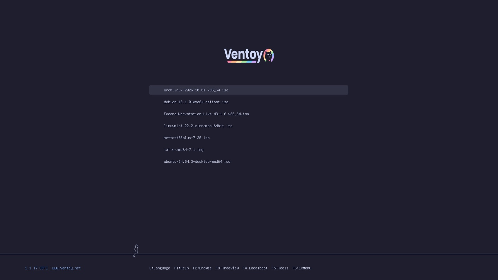 **Catppuccin Mocha** by [Catppuccin](https://github.com/catppuccin/grub) · MIT · F1–F6 key bar | 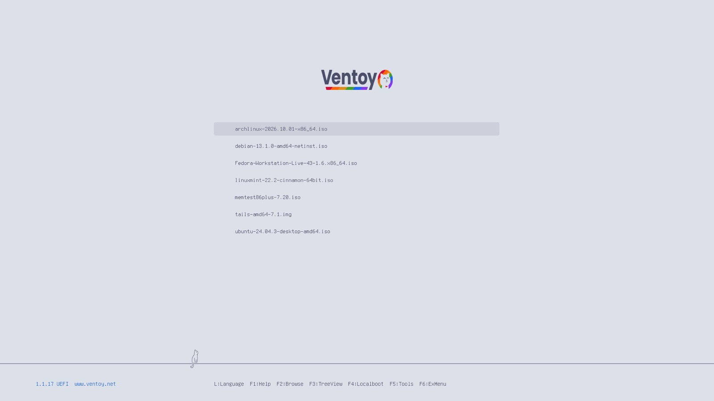 **Catppuccin Latte** by [Catppuccin](https://github.com/catppuccin/grub) · MIT · F1–F6 key bar |
| 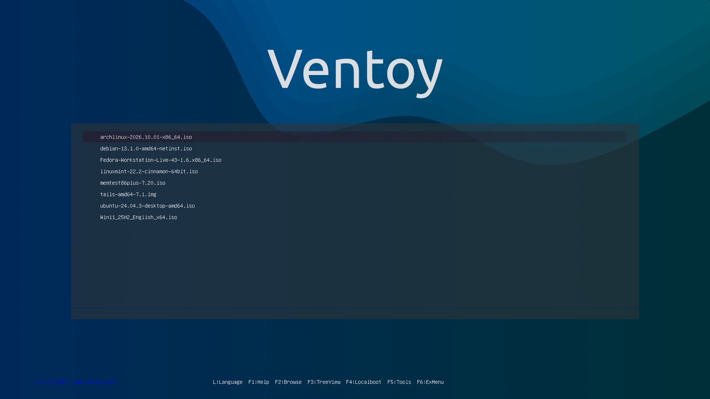 **Adwaita Blue** by [Diego Duarte](https://github.com/odiegoduarte/ventoy-themes) · MIT · F1–F6 key bar | 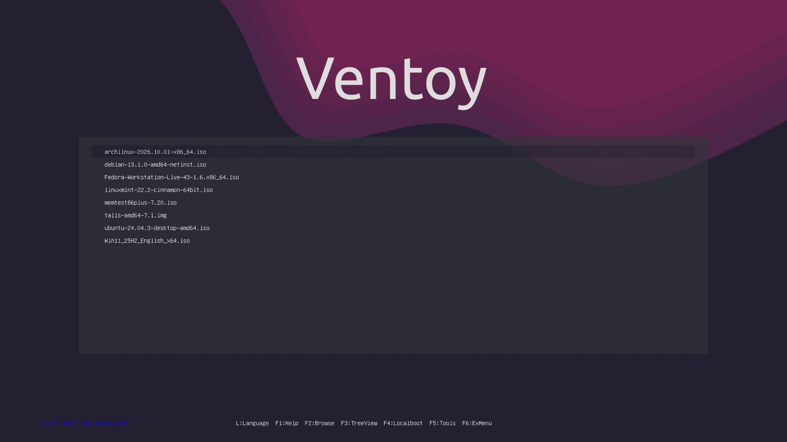 **Adwaita** by [Diego Duarte](https://github.com/odiegoduarte/ventoy-themes) · MIT · F1–F6 key bar |
| 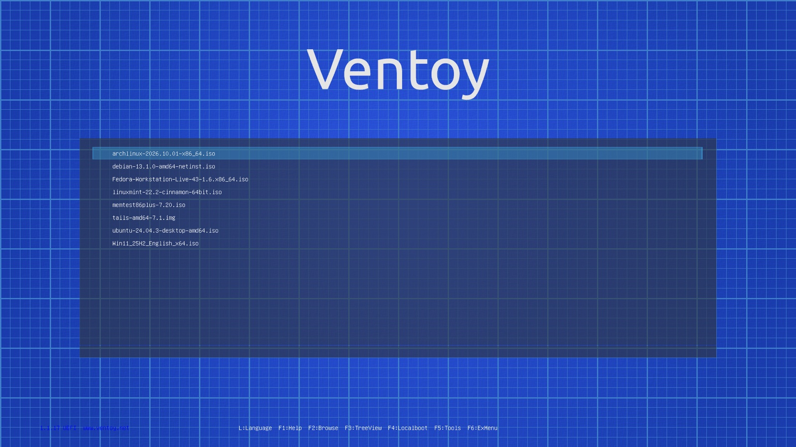 **BluePrint** by [Diego Duarte](https://github.com/odiegoduarte/ventoy-themes) · MIT · F1–F6 key bar | 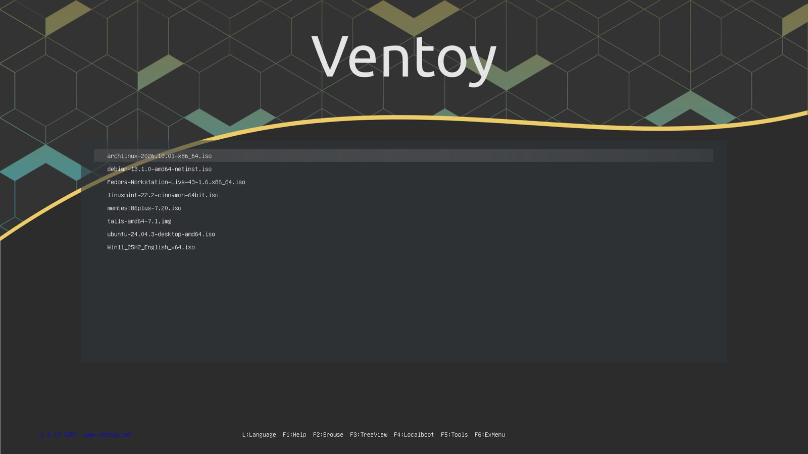 **Pop** by [Diego Duarte](https://github.com/odiegoduarte/ventoy-themes) · MIT · F1–F6 key bar |
| 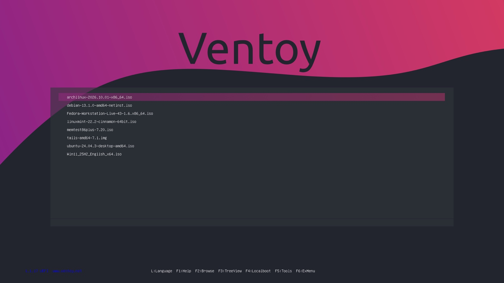 **Purple** by [Diego Duarte](https://github.com/odiegoduarte/ventoy-themes) · MIT · F1–F6 key bar | 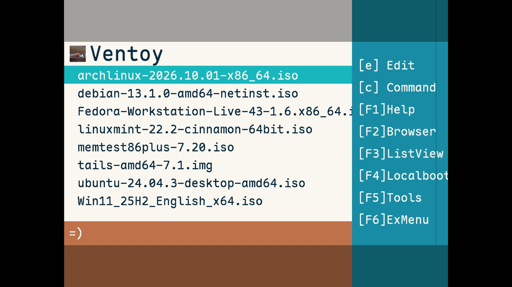 **568flat** by [PJ568](https://github.com/PJ-568/568flat-ventoy-theme) · MIT · F1–F6 key bar |
| 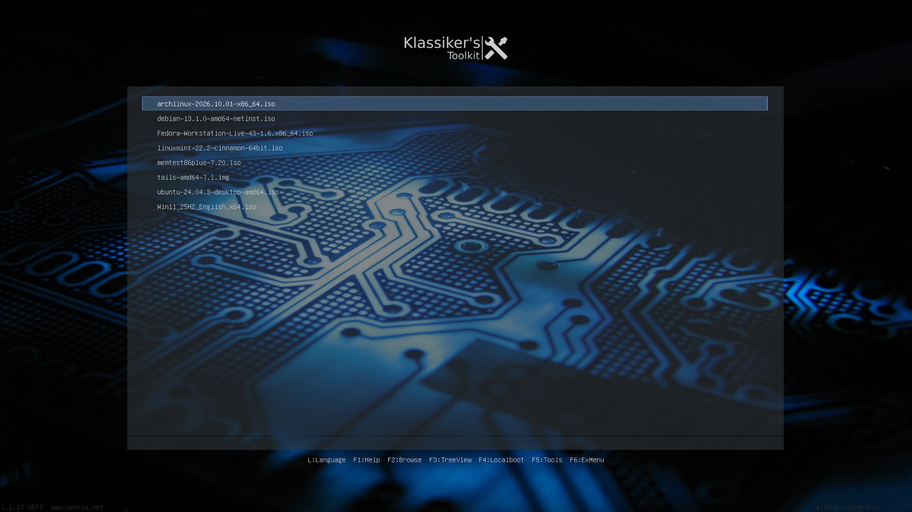 **Klassiker** by [mrdotx](https://github.com/mrdotx/ventoy-theme) · GPL-3.0 · F1–F6 key bar | 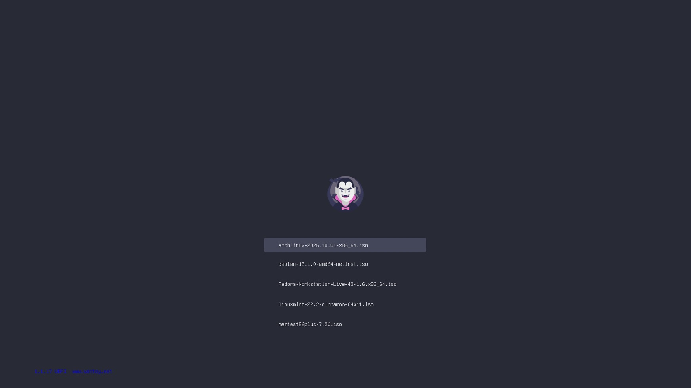 **Dracula** by [Dracula Theme](https://github.com/dracula/grub) · MIT · no Ventoy key bar |
| 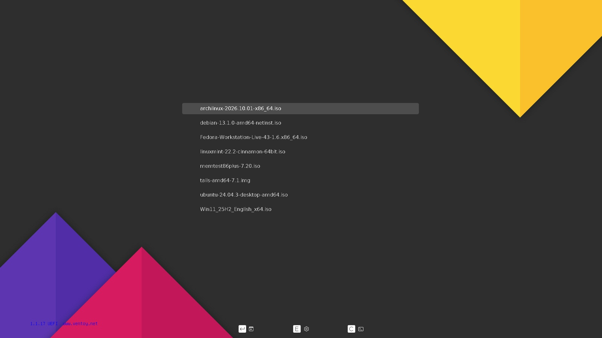 **Tela** by [vinceliuice](https://github.com/vinceliuice/grub2-themes) · GPL-3.0 · no Ventoy key bar | 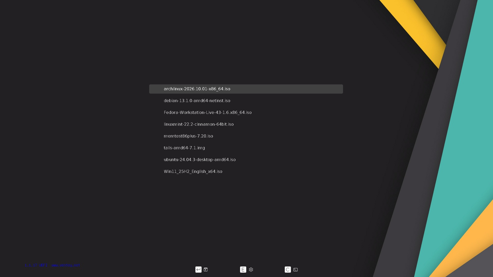 **Stylish** by [vinceliuice](https://github.com/vinceliuice/grub2-themes) · GPL-3.0 · no Ventoy key bar |
| 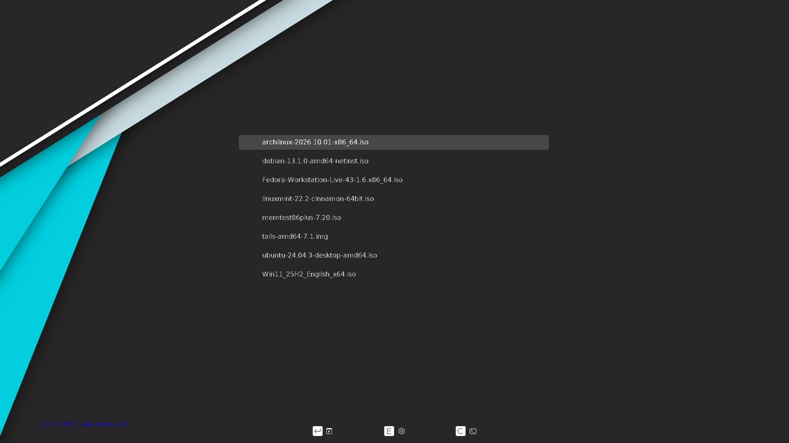 **Vimix** by [vinceliuice](https://github.com/vinceliuice/grub2-themes) · GPL-3.0 · no Ventoy key bar | 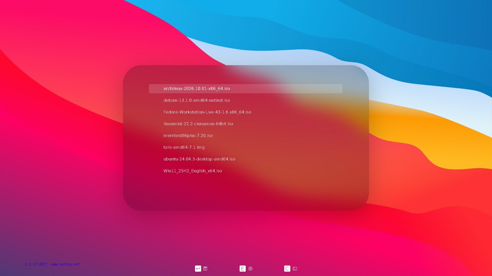 **WhiteSur** by [vinceliuice](https://github.com/vinceliuice/grub2-themes) · GPL-3.0 · no Ventoy key bar |
